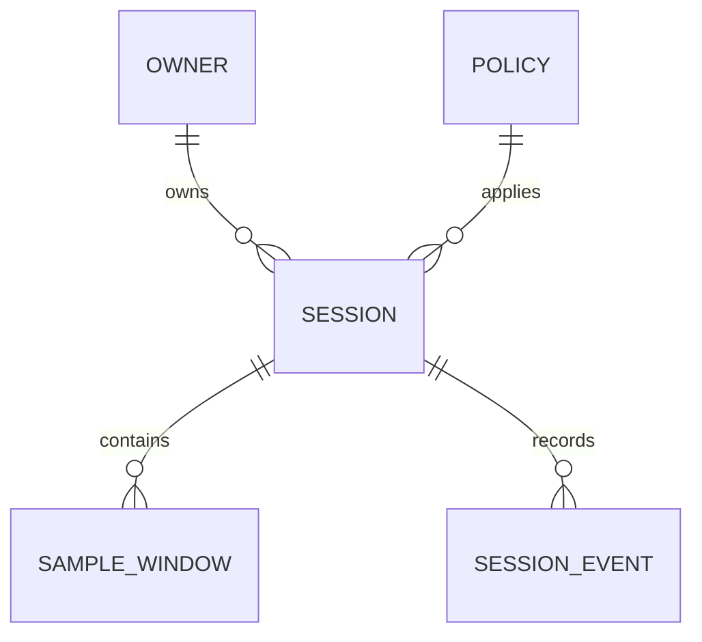

# 세션과 파생 결과 데이터 모델

저장 구조는 설계 제안입니다. 실제 DB와 마이그레이션 방식은 DEC-008에서 선택합니다. 요청 필드는 [OpenAPI](../api/openapi.json)가 기준입니다.

| 엔터티 | 주요 값 | 제약 |
|---|---|---|
| Owner | 내부 소유자 식별자 | 인증 문맥에서 결정. 발급 방식 DEC-005 |
| Policy | id, 불변 설정 snapshot, mapping 상태, approved 여부 | 변경 시 새 id. 서버가 등록·승인한 정책만 세션 생성 허용 |
| Session | id, client_session_id, owner, started_at, ended_at, requested_mode, policy_id, status, final_seq, final_event_seq | 소유자+client_session_id 유일. 완료 후 추가 결과 금지 |
| SampleWindow | session_id, seq, elapsed_start_ms, duration_ms, calibration_epoch, active_mode, quality, 각도·level·reason·confidence | session_id+seq 유일. 같은 seq의 내용 변경 거부 |
| SessionEvent | event_id, event_seq, session_id, elapsed_ms, type, 제한된 payload | event_id 전역 유일, session_id+event_seq 유일. 내용 변경 금지 |

## 시간과 연속성

`seq`는 1부터 증가합니다. 각 창은 1~1000ms이며 창을 건너뛰지 않습니다. 창 길이는 일시정지·무효 시간을 포함하고 마지막 창만 짧을 수 있습니다. 같은 세션에서 창은 겹치지 않고 `previous.elapsed_start_ms + previous.duration_ms = next.elapsed_start_ms`를 충족합니다.

일시정지·수집 중단 시간도 각도가 null인 무효 창으로 표현합니다. 저장 지연 때문에 서버 수신 시각을 측정 시각으로 쓰지 않습니다. 벽시계 시각은 `started_at + elapsed_start_ms`로 해석합니다. 클라이언트 날짜를 신체 활동의 증명으로 취급하지 않습니다.

배치는 순서가 바뀌어 도착할 수 있습니다. 서버는 창을 저장하되 가장 긴 연속 seq를 반환합니다. 종료의 final_seq까지 창과 final_event_seq까지 이벤트가 연속 전송되었는지 확인하고, 누락이 있으면 409로 종료를 보류합니다. final_seq=0은 창이 없는 세션에만 허용합니다. 저장된 최대 seq/event_seq보다 작은 final_seq/final_event_seq는 거부합니다. ended_at은 started_at에 최종 창 끝의 상대 시간을 더한 값과 일치해야 합니다.

## 저장 정책

- 서버 허용: 파생 각도·판정·품질·시간, 모드, 정책 ID, 보정 epoch, 알림 실행·교정 이벤트.
- 로컬 전용: 영상·이미지·관절점, 얼굴·어깨 원본 특징, 보정 원본, pitch/roll 원본 스트림, 회전 속도.
- 원시 데이터 삭제는 세션 종료·권한 해제 때 수행합니다. 파생 결과의 보관 기간은 DEC-006에서 확정합니다.
- 세션 삭제는 창·이벤트·캐시·집계의 관련 값을 함께 삭제합니다. 백업 삭제 정책도 공개 전 확정합니다.

조회용 집계 캐시는 재생성 가능해야 합니다. 원본 결과 창과 정책 snapshot 없이 요약 숫자만 덮어쓰지 않습니다.
