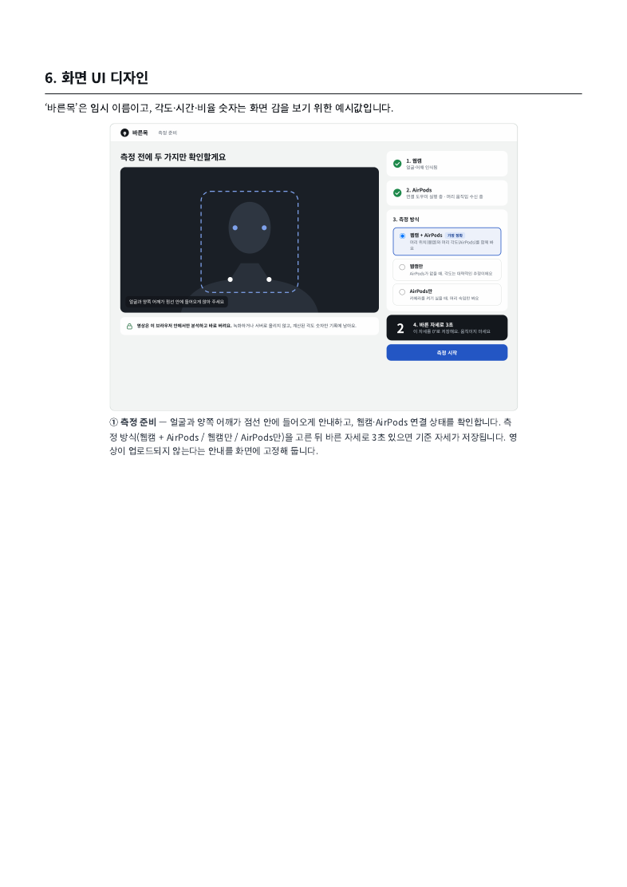
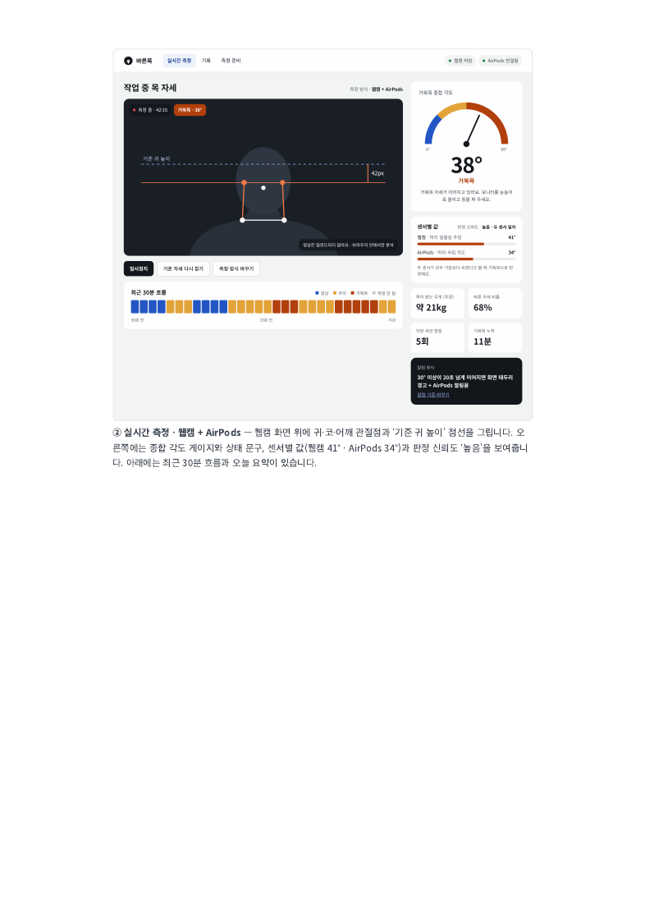
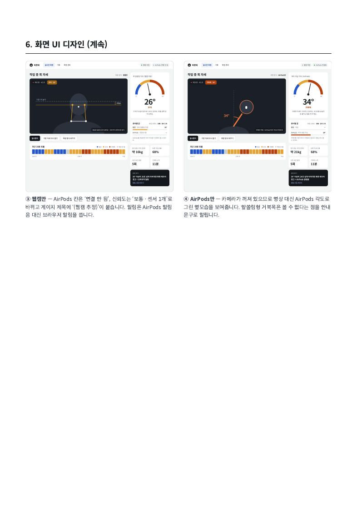
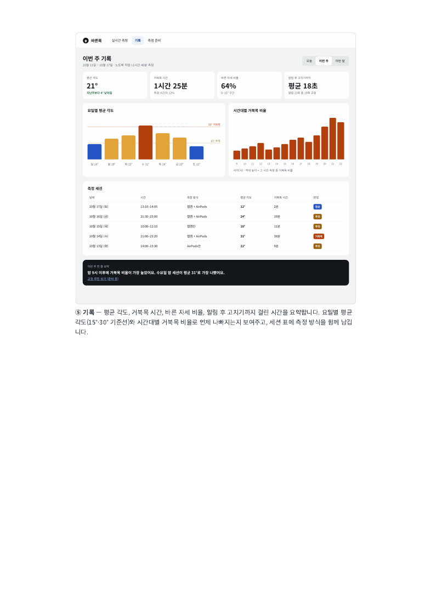

# 준비와 측정과 기록 화면

화면 이름 ‘바른목’과 예시 숫자는 원문 시안입니다. 제품 이름·의료 효과·정확도 검증을 뜻하지 않습니다.

## 준비 화면

- 카메라 미리보기와 얼굴·어깨 안내 틀, 권한·인식 상태, 도우미·모션 수신 상태를 표시합니다.
- 사용 가능한 방식을 선택합니다. 오디오 연결과 모션 수신 가능 상태를 구분합니다.
- ‘기준 자세 잡기’를 실행하면 진행률과 실패 이유를 표시합니다. 안정된 보정이 끝나야 ‘측정 시작’을 활성화합니다.
- ‘영상은 브라우저에서 처리하며 녹화·업로드하지 않음’을 권한 요청 전과 화면에 표시합니다.
- 두 센서를 선택했는데 하나가 없으면 선택 가능한 다른 방식으로 안내합니다. 사용자 선택 없이 센서 권한을 확대하지 않습니다.

## 실시간 화면

| 영역 | 표시 규칙 |
|---|---|
| 관측 영역 | 웹캠·관절점·기준선. AirPods만이면 옆모습 표현. 이미지·좌표는 로컬 전용 |
| 핵심 상태 | 큰 숫자, 상태 문구, 품질, 판정 이유. 무효 상태는 숫자 대신 ‘측정 안 됨’ |
| 센서별 값 | 웹캠 추정값·머리 숙임 값·수신 상태. 미지원·연결 끊김·품질 저하를 구분 |
| 종합값 | 참고값으로 표기. 판정이 센서 조합으로 결정되는 경우 이유를 함께 표시 |
| 최근 흐름 | 최근 30분, 1분 집계. 무효 구간은 회색이며 정상으로 채우지 않음 |
| 조작 | 일시정지·재개, 재보정, 종료, 알림 음소거. ‘방식 변경’은 연결·보정 검사로 이동 |
| 저장 상태 | 저장됨·저장 대기·저장 실패. 측정 실패와 서버 저장 실패를 별도 표시 |

## 센서 한 개로 측정

웹캠만이면 ‘웹캠 추정’을 표시합니다. AirPods만이면 ‘머리 숙임 기준’과 앞쏠림을 놓칠 수 있다는 안내를 표시합니다. 센서 개수에 따른 신뢰도는 관측 범위 설명이며 정확도 백분율이 아닙니다. 원문의 ‘높음/보통’ 표현은 실측 전 정량 신뢰도처럼 쓰지 않습니다.

## 기록 화면

오늘·이번 주·이번 달 필터와 측정 방식·정책 그룹을 제공합니다. 평균 각도, 주의 자세 시간, 기준 범위 비율, 알림 후 교정 시간의 정의는 [집계 명세](../data/statistics.md)를 따릅니다. 요일별 각도·시간대별 비율, 세션 목록·상세, 삭제 기능을 연결합니다.

- 데이터가 없거나 유효 시간이 0이면 0점·정상 대신 ‘산출 불가’를 표시합니다.
- 혼합 모드 세션은 모드별 지표를 구분합니다. AirPods 숙임 시간을 웹캠의 앞쏠림 시간으로 표현하지 않습니다.
- 원문에 없는 확정적 행동 원인·통증 예방·진단 문구를 자동 생성하지 않습니다.
- kg 환산 표시는 DEC-009 해결 전 기본 화면에서 보류합니다.

## 접근성과 오류

상태를 색만으로 구분하지 않고 숫자·문구·아이콘을 함께 제공합니다. 키보드 조작, 초점 유지, 차트의 텍스트 대체를 지원합니다. 권한 거부·장치 없음·도우미 인증 실패·서버 오류는 해당 조치와 함께 표시합니다. 자세 실패를 뜻하지 않는 시스템 오류를 사용자 신체 상태로 표현하지 않습니다.

입력 동작별 허용 조건은 [상태 전이](state-machine.md)를 따릅니다.
