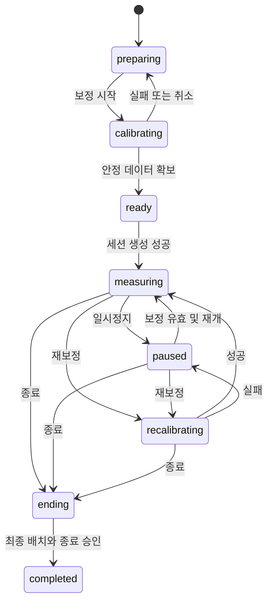

# 측정 상태 전이와 복구

상태는 브라우저 수명주기, 센서 품질, 서버 저장 상태를 나누어 관리합니다. 서버 저장 오류만으로 로컬 판정을 정상·비정상으로 바꾸지 않습니다.

## 전이 조건

| 동작 | 허용 조건 | 처리 |
|---|---|---|
| 시작 | 선택 모드에 필요한 센서 보정·품질 유효 | 세션 생성. 실패 시 ready에서 재시도 |
| 일시정지 | 측정 중 | 판정·알림 후보를 끊고 paused 창을 기록. 장치 수집 중단 가능 |
| 재개 | 기준 자세·장치 배치가 유효 | 단기 창·지속 시간 초기화. 보정 무효면 재보정 |
| 재보정 | 활성 세션 | 기존 기준 적용 중지, calibration_epoch 증가, 진행 중 알림·교정 관찰 종료 |
| 방식 변경 | 필요한 센서 보정 존재 | 현재 발생 구간 닫기, 모드 변경 이벤트. 새 센서는 보정 후 편입 |
| 종료 | 활성 세션 | 장치 해제, 최종 창·이벤트 전송, 서버 연속성 검사 후 완료 |

## 품질 하위 상태

`valid`, `no_sensor`, `low_confidence`, `motion`, `calibrating`, `paused`를 사용합니다. `valid`가 아니면 posture_level은 `unknown`, 모든 파생 각도는 null입니다. 센서 모드는 `webcam`, `airpods`, `combined`, `none`입니다.

두 센서 중 하나가 무효이면 유효한 보정이 있는 나머지 센서로 전환합니다. 복구 센서는 시간 정렬·안정성·보정 유효성을 다시 확인한 뒤 편입합니다. 연결 이벤트만으로 과거 보정이 유효하다고 단정하지 않습니다. 자동 복구 안정 시간은 정책 제안값을 사용하고 DEC-007에서 확정합니다.

## 중단과 저장

- 백그라운드 탭에서 수집이 멈추면 경과 시간을 정상으로 채우지 않고 무효 창으로 기록합니다. 알림 실행 가능성은 별도 기능 감지로 확인합니다.
- 오프라인이면 파생 결과만 제한된 메모리 큐에 보관합니다. 한도 초과·새로고침으로 잃은 시간은 unknown이며 복원된 측정값처럼 만들지 않습니다.
- 종료 전 배치 전송이 실패하면 ending에서 저장 재시도를 제공합니다. 완료 응답 전에 ‘저장 완료’를 표시하지 않습니다.
- 탭 강제 종료는 저장 성공을 보장하지 않습니다. 서버의 미완료 세션은 active로 남고 기록 화면에서 미완료로 표시합니다. 자동 abandoned 처리와 유예 시간은 DEC-010에서 정합니다.

서버의 세션 상태 `active/completed/abandoned`는 위 화면 상태와 별개입니다. 같은 종료 요청은 같은 final_seq·final_event_seq·ended_at일 때 재시도 가능하며 충돌 요청은 409입니다.
